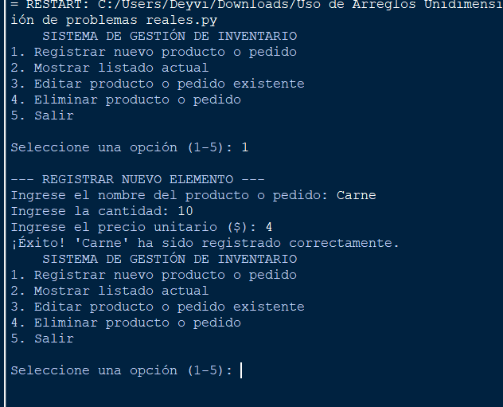
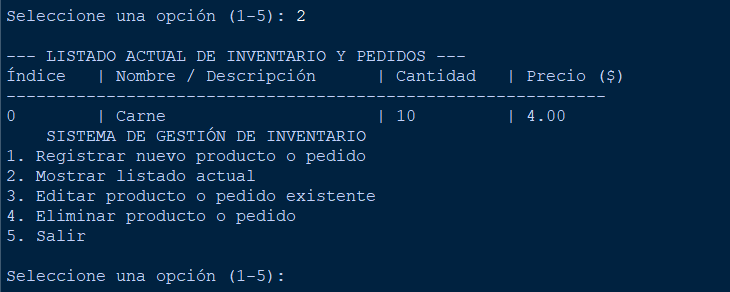
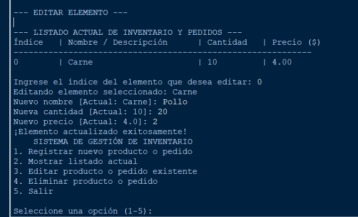
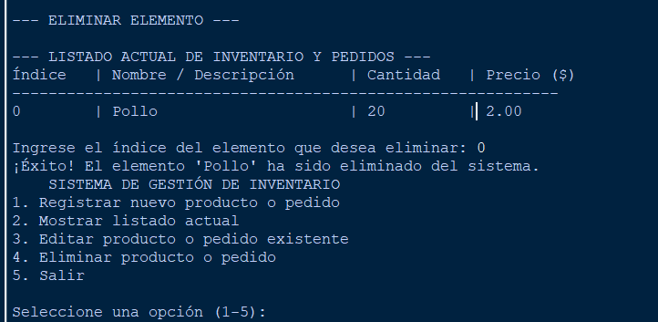
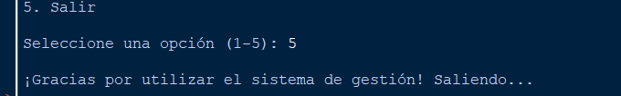

# Sistema Básico de Gestión de Inventario y Pedidos

##  Descripción del Proyecto
Este proyecto es una aplicación de consola desarrollada en Python que permite gestionar de manera eficiente el inventario de productos y pedidos. Utiliza arreglos unidimensionales para almacenar los datos de forma estructurada y aplica conceptos fundamentales de programación modular mediante funciones, estructuras de control y manejo de excepciones.

El programa cubre los siguientes requerimientos mínimos:
1. Registro: Permite añadir nuevos productos o pedidos ingresando nombre, cantidad y precio unitario.
2. Visualización: Muestra un listado en formato de tabla con todos los elementos registrados y sus respectivos índices.
3. Edición: Facilita la actualización de los datos de un elemento existente seleccionándolo por su índice.
4. Eliminación: Permite borrar elementos del sistema manteniendo la consistencia de los arreglos.

---

## Tecnologías y Conceptos Aplicados
* Lenguaje: Python 
* Estructuras de Datos: Listas paralelas.
* Modularización: Funciones y procedimientos especializados.
* Buenas Prácticas: Manejo de excepciones  para validación de entradas de usuario, formato de salida en tablas y comentarios descriptivos.

--- REGISTRAR NUEVO ELEMENTO ---

--- LISTADO ACTUAL DE INVENTARIO Y PEDIDOS ---

--- EDITAR ELEMENTO ---

--- ELIMINAR ELEMENTO ---

--- SALIR  ---
